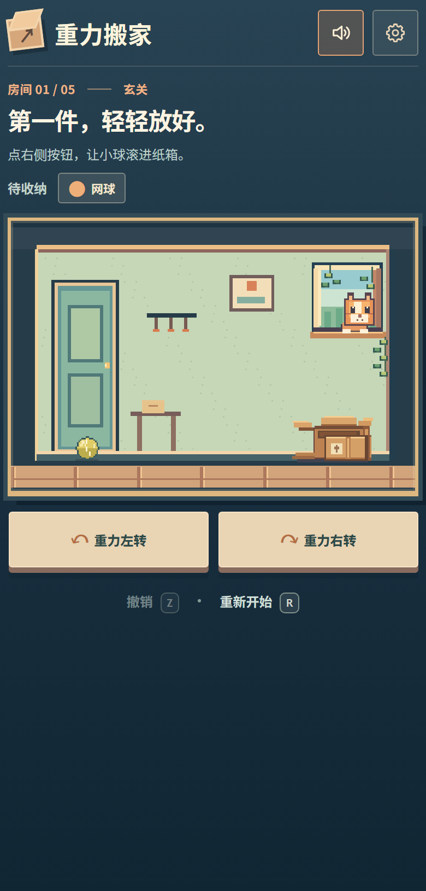

# 重力搬家

一款面向手机浏览器的像素物理解谜小游戏。让房间保持正立，改变重力方向，把物件送进搬家箱。游戏有玄关、书房、客厅、厨房、工作间五个关卡，可选择手机体感或屏幕按钮操作。窗边的小猫会引导第一关，并在关卡之间送上一句提示。

**在线测试链接：** [https://zhengads.github.io/gravity-moving/](https://zhengads.github.io/gravity-moving/)



## 在手机上测试

1. 用手机浏览器打开上面的 HTTPS 链接，先选择“点击按钮”，确认游戏和关卡可正常运行。
2. 刷新页面，选择“倾斜手机”；如果浏览器请求运动传感器权限，请允许访问。
3. 手机竖屏打开时会先提示横屏体验；横过手机后，房间按原始比例铺满屏幕高度，操作键放在两侧。缓慢倾斜手机，观察物件运动；哪一侧压低，物件就应朝哪一侧滚动。也可以保持竖屏游玩。右上角齿轮可切换操作方式、选择五间房。音效默认开启，小猫逐字对话时有轻短的像素打字声；扬声器图标可随时静音，没有循环背景音乐。书房的阅读灯自行摆动，客厅要借木块打开通道，厨房有自动弹跳的垫子，工作间的传送带会自行换向。玩家只需控制重力，观察环境的节奏并借力把物件送进箱子。

体感需要设备提供运动传感器，并由浏览器开放相关接口。无法获取传感器数据时，游戏会回退到按钮操作。体感优先读取倾角，倾角中断时才用加速度；横屏时按屏幕旋转角度调整坐标。实际方向与手感仍需在目标手机上测试。如果方向与手持姿势不符，可打开[传感器诊断页](sensor-check.html)记录原始读数；该页面不会自动上传数据。

## 本地构建

需要 Node.js。安装锁定依赖并生成独立 HTML：

```bash
npm ci
npm run build
```

构建产物是仓库根目录的 `index.html`，其中内嵌 Matter.js、游戏脚本、像素画绘制代码、样式和字体；无需后端或数据库。普通操作可直接打开该文件；手机体感测试请使用上面的 HTTPS 页面。

## 项目结构

```text
├─ index.html             # GitHub Pages 发布的单文件构建产物
├─ build.mjs              # 将源码与素材打包进 index.html
├─ src/
│  ├─ template.html       # 页面结构与弹窗
│  ├─ style.css           # 响应式布局与视觉样式
│  ├─ app.js              # Matter.js 物理、关卡、体感与交互
│  ├─ pixel-art.js        # 五间房间、物件、小猫和风的像素绘制
│  └─ fonts/              # 字体子集及其 OFL 许可证
└─ docs/mobile-start.png  # 手机端界面预览
```

游戏使用 Canvas 2D 绘制场景，用 Matter.js 处理碰撞与运动；体感优先读取 `DeviceOrientationEvent`，必要时使用 `DeviceMotionEvent`。字体许可证见 `src/fonts/`。
